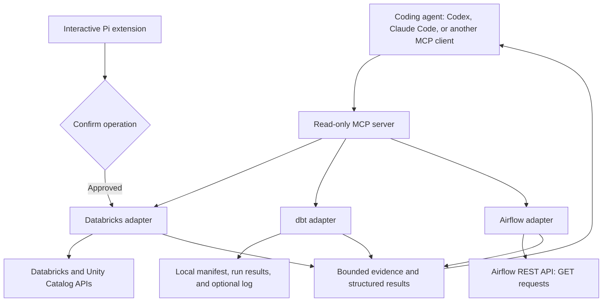

# ETL Agent Tools

Investigate Databricks, dbt, and Airflow failures from your coding agent. Gather run evidence, follow dependencies, and compare a failing dbt run with a successful one.

**Status:** beta (`0.2.0-beta.1`). The MCP server reads evidence. The separate Pi extension can submit Databricks operations after interactive confirmation.

[Quick start](#quick-start) · [Architecture](#architecture) · [Tools](#tools) · [Local demo](#local-transaction-reconciliation-demo) · [Documentation](#documentation)

## What you can do today

| System | Available now |
| --- | --- |
| Databricks | Inspect jobs, runs, pipelines, schemas, and notebooks; read Unity Catalog lineage and grants; optionally inspect job cost. |
| dbt Core | Diagnose local run artifacts and compare them with a successful baseline you supply. |
| Airflow | Inspect DAG runs, task instances, and bounded task logs through the REST API. |

Use it with **Codex, Claude Code, DeepSeek Harness, Pi, or another MCP client**. MCP (Model Context Protocol) lets your agent call the tools. The agent supplies the language model; this package does not host one.

## Quick start

The steps below use Codex and existing local dbt artifacts. You can try this path without cloud credentials.

**You need:** Node.js 22+, npm, Git, a working Codex installation, and a dbt output directory containing `manifest.json` and `run_results.json`.

### 1. Install from this repository

```sh
git clone https://github.com/MonishGosar/etl-skills.git
cd etl-skills
npm ci
npm run build
npm install --global .
```

This installs the checked-out version, including `etl_compare_runs`. See [other installation options](docs/SETUP.md) for the published beta, Claude Code, Pi, and DeepSeek Harness.

### 2. Connect your data project

In the repository you want to investigate, run:

```sh
cd /path/to/your/data-project
etl-agent-tools-setup --harness codex
```

Setup installs shared skills, adds `.codex/config.toml`, and creates `.etl-agent/project.md`. It records environment variable names without saving secret values. Codex must trust the project for its project configuration to load.

### 3. Point to your dbt artifacts

Set the variable in the terminal that will launch Codex:

```sh
export DBT_ARTIFACTS_DIR="/absolute/path/to/dbt/target"
```

<details>
<summary>Windows PowerShell</summary>

Use `npm.cmd` in place of `npm` if PowerShell blocks the npm script. Set the path with:

```powershell
$env:DBT_ARTIFACTS_DIR = "C:\path\to\dbt\target"
```

</details>

The package reads existing artifacts; it does not run dbt. It also does not load `.env` files automatically. For cloud access, follow [Databricks configuration](ENVIRONMENT_SETUP.md#databricks-implemented) or [Airflow configuration](ENVIRONMENT_SETUP.md#apache-airflow-implemented-read-only).

### 4. Verify the connection and investigate

```sh
codex mcp list
codex
```

Confirm that the `etl` server is listed. Inside Codex, ask:

> Call `etl_capabilities` to check my configuration, then use `etl_diagnose` with provider `dbt` to investigate the failed run. Show the primary failure, upstream evidence, and suggested next step.

`etl_capabilities` checks configuration without contacting a remote workspace. Restart the agent after changing environment variables.

## Architecture



1. Your agent calls a tool with a provider and investigation target.
2. The adapter reads run data, metadata, or local artifacts. dbt and Airflow diagnosis add a failure category and dependency context.
3. Results return with provider identity, size limits, and scrubbed error excerpts. The agent uses that evidence to explain the incident.
4. In Pi, a separate confirmation gate protects SQL submission, job and pipeline control, and repairs.

The MCP cannot start runs, execute dbt, submit arbitrary SQL, or repair jobs. Its Unity Catalog helper can submit fixed read-only `SELECT` statements for lineage fallback and optional job cost when a warehouse is configured.

See [the architecture guide](docs/ARCHITECTURE.md) for the code layout, comparison rules, and execution boundaries.

## Tools

These six tools are exposed by the MCP server:

| Tool | Use it to… |
| --- | --- |
| `etl_capabilities` | Check configured providers and available operations. |
| `etl_inspect` | Read Databricks objects, dbt artifact summaries, or Airflow run/task evidence. |
| `etl_diagnose` | Build a failure brief for a dbt invocation or Airflow DAG run. |
| `etl_compare_runs` | Compare current dbt artifacts with a successful baseline. |
| `etl_uc_context` | Read Unity Catalog lineage, grants, and optional job cost. |
| `etl_query_status` | Inspect an existing Databricks SQL statement and bounded results. |

### Compare two dbt runs

Ask your agent to call `etl_compare_runs` with:

```json
{
  "artifacts_dir": "/project/current/target",
  "baseline_artifacts_dir": "/project/last-good/target"
}
```

Each directory needs its own `manifest.json` and `run_results.json`. You choose the successful baseline. The tool reports code/configuration fingerprints, declared column metadata, and dependency changes. Changes are investigation candidates; they do not establish the cause by themselves.

### Local transaction reconciliation demo

From this repository, after `npm ci` and `npm run build`, run the demo with [uv](https://docs.astral.sh/uv/getting-started/installation/):

```sh
uv run --no-project --with dbt-duckdb==1.11.1 --with dbt-core==1.12.6 --with duckdb==2.0.0 python examples/transaction-reconciliation/run_demo.py --output benchmark-output/reconciliation.json
```

The demo creates a disposable dbt/DuckDB project. It injects an incremental-model defect, compares artifacts, and applies a supplied fixture patch:

| Stage | Expected output |
| --- | --- |
| Faulty run | Model succeeds, but data tests fail: 6 rows / 6,000 cents. |
| Repaired run | Tests pass: 3 unique transactions / 3,000 cents. |
| Repeat build | The repaired totals and unique IDs remain correct. |

This exercises a known local repair. Automatic patch generation and general repair orchestration remain planned. See [the recorded report](benchmarks/results/reconciliation-demo.json).

## Benchmarks and development

The authored classification suite improved from **36/54 to 54/54** cases. It measures error categories using local dbt artifacts and mocked Airflow responses. Reserved wording cases share authored error families with development cases; they are not an independent project holdout. The score does not measure production repair success.

From the repository root:

```sh
npm run verify
npm run benchmark -- --split dev --gate
npm run benchmark -- --split holdout --gate
```

`verify` checks types, builds the package, runs tests, and verifies a packed installation. These checks need no Databricks credentials. See [benchmark methodology and raw results](benchmarks/README.md).

## Documentation

| Guide | Read it for… |
| --- | --- |
| [Setup by agent](docs/SETUP.md) | Codex, Claude Code, DeepSeek Harness, Pi, and other MCP clients. |
| [Environment setup](ENVIRONMENT_SETUP.md) | Databricks PAT/OAuth, dbt paths, Airflow authentication, and credential handling. |
| [Architecture](docs/ARCHITECTURE.md) | Adapters, diagnosis, comparison, and the Pi confirmation gate. |
| [Roadmap](docs/ROADMAP.md) | Planned recovery workflows and how we intend to evaluate them. |
| [Security](SECURITY.md) | Access boundaries, credential handling, and reporting issues. |
| [Release plan](RELEASE_PLAN.md) | Remaining live compatibility checks and release gates. |
| [Changelog](CHANGELOG.md) | User-visible changes. |

Automatic baseline discovery, live Git/schema comparison, and autonomous repairs remain future work. Snowflake and dbt Cloud adapters are also planned; see [provider expansion](FUTURE_WORK.md).
