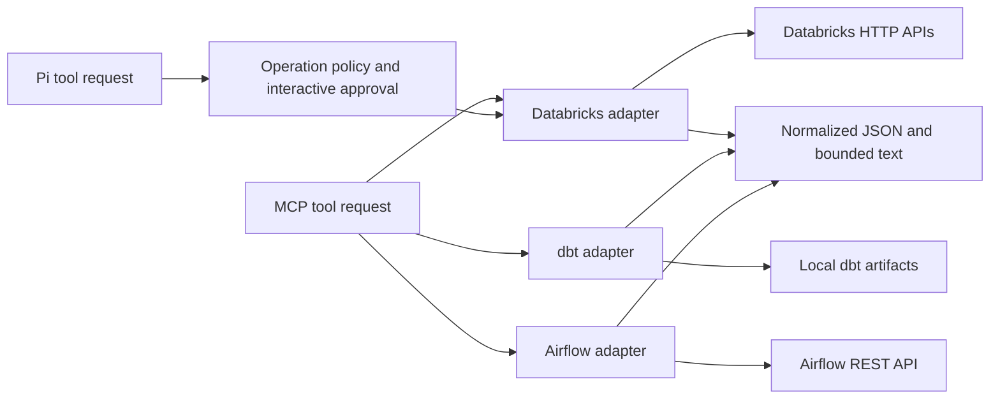

# ETL Agent Tools architecture

[Back to the README](../README.md#architecture)

ETL Agent Tools runs inside an existing coding-agent workflow. It supplies tools and shared skills; the host agent supplies the language model and conversation.

## Entry points

| Entry point | Implementation | Responsibility |
| --- | --- | --- |
| Read-only MCP server | [`src/mcp.ts`](../src/mcp.ts) | Registers six investigation tools and serves them over stdio. |
| Interactive Pi extension | [`extensions/databricks.ts`](../extensions/databricks.ts) | Registers Databricks inspection and guarded execution tools. |
| Shared skills | [`skills/`](../skills/) | Guides workspace setup, diagnosis, schema review, lineage, and repair. |
| Setup command | [`src/setup.ts`](../src/setup.ts) | Installs skills and project configuration without recording secret values. |

The MCP and Pi extension are separate entry points. Pi does not pass through the MCP server to perform mutations. Its native tools are Databricks-specific; the dbt comparison tool is exposed through MCP.

## Adapters and shared policy

| Module | Role |
| --- | --- |
| [`src/core.ts`](../src/core.ts) | Adapter types, operation classes, approval requirements, and result limits. |
| [`src/databricks-adapter.ts`](../src/databricks-adapter.ts) | Databricks inspection and execution policy. |
| [`src/databricks-auth.ts`](../src/databricks-auth.ts) | PAT or OAuth machine-to-machine credentials and token refresh. |
| [`src/unity-catalog.ts`](../src/unity-catalog.ts) | Lineage, grants, and optional billing context. |
| [`src/dbt-adapter.ts`](../src/dbt-adapter.ts) | Bounded artifact reads, dependency graph, and failure selection. |
| [`src/dbt-comparison.ts`](../src/dbt-comparison.ts) | Successful-baseline/current snapshot comparison. |
| [`src/airflow-adapter.ts`](../src/airflow-adapter.ts) | DAG/task evidence and diagnosis through GET requests. |
| [`src/diagnosis.ts`](../src/diagnosis.ts) | Failure categories, evidence excerpts, and suggested next steps. |

## Following a dbt investigation

1. Read `run_results.json`, `manifest.json`, and an optional `dbt.log` from the configured local directory.
2. Build the dependency graph and identify upstream-most failing candidates. Independent failures and cycles remain uncertain.
3. Prefer the selected node's error over an unrelated invocation-wide log error.
4. Return the selected subject, failure category, bounded evidence, impact, and suggested next step.

For `etl_compare_runs`, the caller supplies separate current and successful-baseline artifact directories. The comparison checks baseline success, project/invocation consistency, and timestamp ordering where metadata exists. Missing metadata is reported as uncertainty.

The result includes code/configuration fingerprints, declared column metadata, and dependency changes ranked by their relationship to the selected subject. Raw SQL and configuration values stay out of comparison results. An optional `node_id` can focus on a successful model whose downstream data tests failed.

Declared columns describe the manifest, not the live warehouse schema. Observed changes remain candidates until reproduction and validation support causality. Comparison executes no dbt, Git, SQL, or repair command.

## Read and execution boundaries

| Path | Allowed behavior |
| --- | --- |
| MCP | Read evidence; no arbitrary SQL, dbt execution, job/pipeline control, or repair. |
| Unity Catalog helper | Read APIs, plus fixed `SELECT` statements for a lineage fallback and optional job cost. These require a configured warehouse; unavailable sections report `available: false`. |
| Pi | Databricks SQL submission, cancellation, job/pipeline actions, and repair require an interactive confirmation gate. |
| Reconciliation demo | A separately invoked development script creates a disposable local database and applies a supplied fixture patch. |

Result text is capped at 24,000 characters. Oversized structured results are omitted with a truncation marker. Error excerpts are capped and scrubbed; provider error bodies are discarded. Returned logs and notebook content remain untrusted evidence for the agent.

A submitted remote operation is not necessarily complete. Inspect its returned identifier and poll to a terminal state. Starting or repairing a Databricks run uses deployed code; it does not deploy a local patch. Catalog/schema defaults resolve names without enforcing isolation.

See [security boundaries](../SECURITY.md) and [environment configuration](../ENVIRONMENT_SETUP.md).

## Alongside Databricks managed MCP servers

Use Databricks managed MCP servers for Genie, ad hoc SQL, Unity Catalog functions, and AI Search. Use this package for failed-run evidence, lineage/grants, dbt and Airflow diagnosis, and Pi's guarded execution path.

Both can connect to the same agent, using separate credentials if needed. This package does not register or replace managed servers. Follow [Databricks-provided MCPs](https://docs.databricks.com/aws/en/agents/mcp-tools/) and [Databricks agent skills](https://docs.databricks.com/aws/en/agent-skills/) for their setup.
